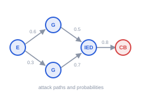
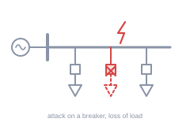
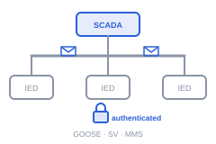
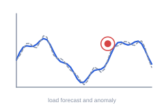
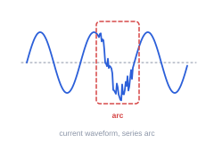

# Research

I work on the **cyber-physical security and resilience of electric grids**, especially digital substations built on IEC 61850.

<!-- One block per research theme. Copy a block to add one. The picture is in assets/research/ (swap in a figure from your paper using the same file name). -->

  
  

    <h2>Vulnerability assessment of substations</h2>
    
Bayesian attack graphs that use device similarity and the MITRE EMB3D threat map to rank how an attacker can reach critical devices.

    
<a href="/publications/">Papers: IEEE TII (in review) · PESGM 2025</a>

  

  
  

    <h2>Grid impact of attacks</h2>
    
What happens to the grid when a substation is attacked, using a node-breaker model that captures breaker and switching actions.

    
<a href="/publications/">Papers: IEEE IAS 2026 · in preparation</a>

  

  
  

    <h2>Secure substation communication</h2>
    
Authenticating GOOSE and SV messages, and software-defined, information-centric networking for IEC 61850. Includes a granted patent on circuit-breaker commands.

    
<a href="/publications/">Papers: ISGT Asia 2024 · Patent</a>

  

  
  

    <h2>Cyber risk and load forecasting</h2>
    
Short-term forecasting in unusual conditions, with machine learning to detect anomalies and classify cyberattacks on the data.

    
<a href="/publications/">Paper: IET CPS 2025</a>

  

  
  

    <h2>Protection and signal processing</h2>
    
Spotting faults that normal protection can miss, such as series arcs, hotspots and lost neutral grounding, with signal processing on embedded hardware.

    
<a href="/publications/">Papers: PESGRE 2025 · IEEE TPWRD (under review)</a>

  

